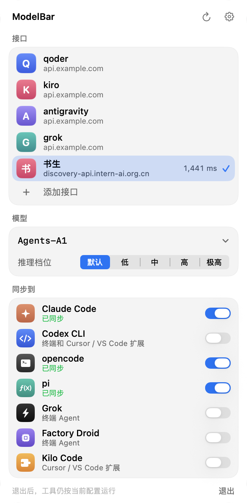
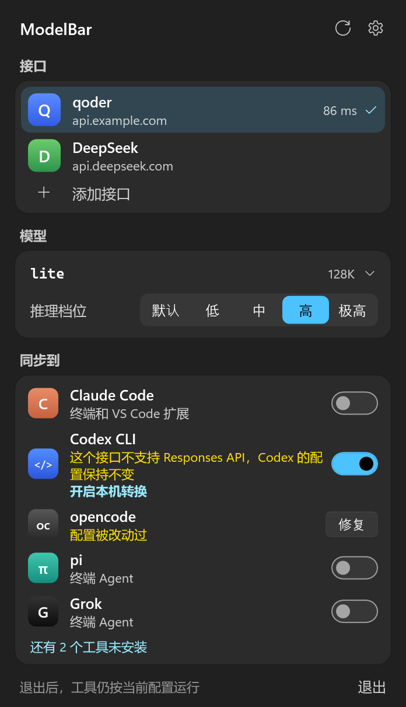
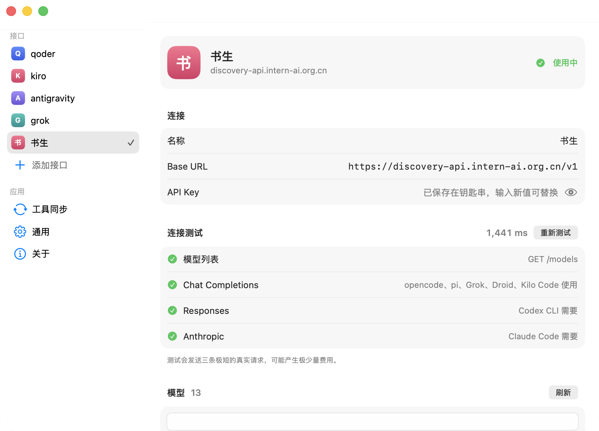
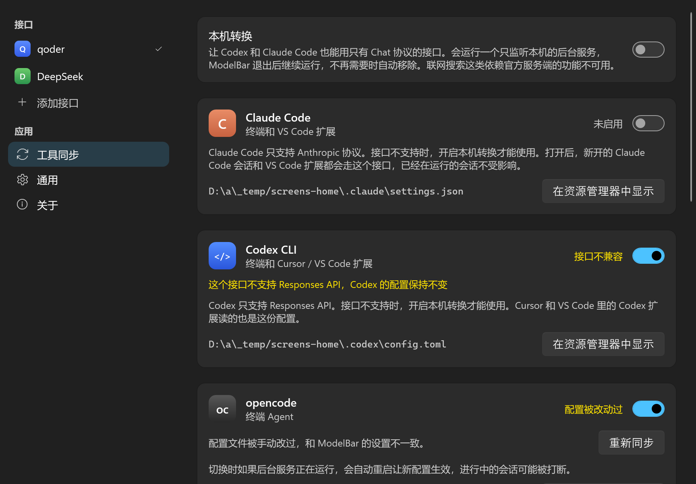

# ModelBar

在 Mac 菜单栏统一管理你的 API 接口，一键同步到官方支持自定义接口的工具。

不修改 Cursor 或任何工具的程序文件，只写它们公开的配置文件，所以工具更新不会影响使用。

Windows 版在 [windows](windows/README.md) 目录。

## 截图

<table>
  <tr>
    <th>Mac</th>
    <th>Windows</th>
  </tr>
  <tr>
    <td valign="top"></td>
    <td valign="top"></td>
  </tr>
  <tr>
    <td valign="top"></td>
    <td valign="top"></td>
  </tr>
</table>

## 安装

运行 `./scripts/package-dmg.sh` 生成 `dist/ModelBar.dmg`，把里面的 ModelBar 拖进“应用程序”，然后打开。它只出现在菜单栏，不占程序坞。

如果菜单栏太挤、看不到图标，再次打开 ModelBar 就会直接弹出面板。

## 使用

1. 点菜单栏图标，选“添加接口”，填入 Base URL 和 API Key。添加后会自动拉取模型并测试连接。
2. 选模型和推理档位。
3. 在“同步到”里打开要用的工具。

之后切换接口、模型或档位，已打开的工具都会立即同步。退出 ModelBar 后，工具继续按当前配置运行。

## 支持的工具

| 工具 | 在哪里用 | 写入的配置 | 接口要求 |
|---|---|---|---|
| Claude Code | 终端、VS Code 扩展 | `~/.claude/settings.json` | Anthropic；只有 Chat 时需开启本机转换 |
| Codex CLI | 终端、Cursor / VS Code 扩展 | `~/.codex/config.toml` | Responses；只有 Chat 时需开启本机转换 |
| opencode | 终端 | `~/.config/opencode/opencode.json` | Chat Completions 或 Responses |
| pi | 终端 | `~/.pi/agent/models.json`、`settings.json` | Chat Completions 或 Responses |
| Grok | 终端 | `~/.grok/config.toml` | Chat Completions |
| Factory Droid | 终端 | `~/.factory/settings.json` | Chat Completions 或 Responses |
| Kilo Code | Cursor / VS Code 扩展 | `~/.config/kilo/kilo.json` | Chat Completions 或 Responses |

面板只显示已安装的工具。

其他工具（比如 Cline）可以在接口详情页拷贝 Base URL、模型名和 Key，手动填入。

## 限制

- **Cursor 自带的 Agent 面板和 Tab 补全用不了这些接口。** 在 Cursor 里要用 Kilo Code 扩展的面板。
- **接口只有 Chat 时，Codex 和 Claude Code 默认不会切换。** ModelBar 不写入配置，它们保持原样。需要时可以开启下面的本机转换。
- **Grok 的推理档位不生效。** 它不支持给自定义模型设置档位。
- **Factory Droid 需要登录 Factory 账号。** 它只接受明文 Key，所以 Key 会写进它的配置文件（权限 0600），关闭开关时移除。
- **推理档位能否生效取决于服务商。** ModelBar 负责把 `reasoning_effort` 发出去。
- **测试范围：** Claude Code、Codex、opencode、pi、Grok 和 Kilo Code 都用真实程序跑过对话和工具调用。Kilo Code 用的是扩展自带的命令行程序，没有测过编辑器里的面板。**Factory Droid 没有实际运行过**，它的配置格式和已有的自定义模型一致。
- 其他也会改 `~/.codex/config.toml` 的工具可能和 ModelBar 互相覆盖。ModelBar 发现配置被改后会提示，不会自动改回去。

## 本机转换

Codex 只支持 Responses API，Claude Code 只支持 Anthropic 协议，而很多接口只有 Chat。开启“本机转换”后，ModelBar 会运行一个后台服务：工具连接本机，服务把请求翻译成 Chat 发给接口，再把回复翻译回来。

**怎么开启：** 接口只有 Chat 时，打开 Codex 或 Claude Code 的开关，面板里会出现“开启本机转换”。在“工具同步”页面也能开关。

**运行方式：** 服务由系统的 launchd 托管，ModelBar 退出后继续运行，崩溃后自动重启。关闭转换、关闭相关开关或切到原生支持的接口时，服务会被移除，工具配置随之恢复或改回直连。应用更新后，服务会自动重启到新版本。

**可用的功能：** 普通对话、流式输出、工具调用（包括执行命令）、多轮对话、推理档位、图片。

**不可用的功能：** 联网搜索这类由官方服务端执行的工具，翻译时会被去掉。

**安全措施：**
- 只监听 `127.0.0.1`，局域网访问不到。
- 请求必须带本机访问令牌，令牌存在权限 0600 的文件里。
- 校验 Host，防止网页通过 DNS 重绑定访问。
- 日志记录路径、状态、耗时和上游的报错（最多 200 字，已抹掉 Key），不记录请求内容，位置是 `~/Library/Logs/ModelBar/bridge.log`。

**测试情况：** 已用真实的 Codex、Claude Code 和一个真实的 Chat 接口跑通普通对话和工具调用。其他服务商可能拒绝部分参数，比如 `stream_options`、`reasoning_effort`，遇到时工具会显示接口返回的错误。图片目前只有单元测试。

**模型要求：** 模型必须支持工具调用，否则工具能聊天但不能执行命令。

**启动时的提示：** Codex 可能显示 `Model metadata ... not found`，Claude Code 可能提示不认识这个模型。这是因为它们不认识这个模型，会改用默认设置。

## 数据和安全

- 主密钥存在系统钥匙串。
- 工具读不了钥匙串，所以当前接口的 Key 会另存一份权限 0600 的文件，切换接口或停用全部工具时自动删除。如果某个工具还停留在上一个接口，它的 Key 文件会保留到下次全部同步成功。
- 工具的配置文件里只写这个文件的路径，不写 Key 本身（Factory Droid 除外）。
- 打开 Claude Code 的开关时，原来的 `ANTHROPIC_AUTH_TOKEN` 会移到 ModelBar 的设置文件里（权限 0600），关闭开关时放回。
- 每次改配置前自动备份，每个工具保留最近 10 份，位置是 `~/Library/Application Support/ModelBar/backups`。
- 关闭工具的开关会恢复它原来的配置。
- “测试连接”会发送三条极短的真实请求，可能产生极少量费用。除此之外，ModelBar 只在你操作时访问你填写的接口，不连接其他服务器。

opencode 的后台服务不会自动读取新配置，所以切换时如果它正在运行，ModelBar 会重启它，进行中的会话可能被打断。

## 卸载

先在面板里关掉所有工具的开关，这会恢复它们原来的配置并移除转换服务。然后退出 ModelBar，把它移到废纸篓。

## 从源码构建

只需要 Command Line Tools，不需要完整的 Xcode。

```bash
./scripts/build-app.sh
```

```bash
./scripts/package-dmg.sh
```

```bash
./scripts/test.sh
```

先运行一次 `./scripts/make-signing-cert.sh`，它会在登录钥匙串里创建固定的签名证书，之后构建的版本更新时不用重新授权钥匙串。没有这个证书时构建会退回临时签名，每次更新都会询问。第一次换到这张证书时，每个已有的密钥还会询问一次。证书只在这台 Mac 上，换电脑要重新创建；发布的 DMG 要一直用同一张证书签名，否则用户更新时又要重新授权。

运行 `MODELBAR_KEYCHAIN_TEST=1 ./scripts/test.sh` 会额外测试真实钥匙串，结束后自动删除测试条目。

把环境变量 `MODELBAR_HOME` 指向一个空目录，应用的所有读写都会限制在那个目录里，不碰真实配置和钥匙串，适合调试。
